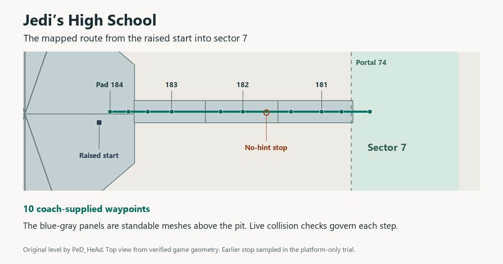

# CTF and unfamiliar-level play

Jan and Boba played ordinary native clients in an isolated arena. The trial schedule crosses free-for-all, skin-team deathmatch and capture the flag with gun or saber-only bot controls and enabled or disabled Force. Each non-FFA match puts the players on opposing teams. In a new level each client reads the current geometry and builds its own routes. A stored directed-edge cost can affect future searches after a real stall. The cost decays, and later successful travel can reduce it. [Schedule amended before JHS play](../qa/adjoin-arena-mode-coverage-jhs-schedule.json) · [Run a match](RUN_RED_ARENA.md) · [Native implementation and controlled pathfinder test](../native/README.md)

## Flag play

The stock scoring script emitted the following completed captures. The dedicated host and both player logs independently reported the scoring events. Each match lasted 90 measured game seconds at 2×. Red's CTF controller selected the objectives. Navigation could learn from each player's route outcomes.

| Stock level | Bot rules | Red captures | Gold captures |
|---|---|---:|---:|
| C1 | Guns, Force on | 2 | 2 |
| C2 | Sabers, Force off | 1 | 1 |
| C3 | Guns, Force off | 0 | 0 |
| C1 | Sabers, Force on | 1 | 1 |

In the guns match on C1, both clients observed opposing carriers take flags away from home. All four completed captures coincided with a carried flag returning home and a 15-point change. The final scoreboard read 39–39 because the game also awards points for other actions. On C3 the bots repeatedly chose to pursue the flag and moved through 17 and 18 sectors. Both flags stayed home for the entire observation. These counts preserve the difference between selecting a tactic and completing it.

Every match here had one bot on each team. C1 provided no examples of choosing between attack and defense with a free teammate, or escorting a teammate carrying the flag. Training a neural selector for those decisions requires teammates and examples of both legal assignments. The pickup model learns a different decision and uses the mode registry to select its eligible games. [Pickup model](RED_PICKUP_MODEL.md) · [Registry](../bots/models/red_pickup_registry.json)

## Returning to an unfamiliar level

### Jedi's High School

Andrei selected PeD_HeAd's original JK multiplayer level, version 1.0. The two clients verified the local GOB and the 216-sector JKL independently before their first playable frame. The archive, level bytes, two join orders and 75-second sessions were fixed before either JHS game. Both games ran at 2× on the host and on both clients. [Original map and source checksums](https://github.com/CodaLilitari/World-Between-Worlds/blob/codex/massassi-top50/jhs_catalog.py) · [Original two runs in the matrix evidence](../qa/adjoin-arena-mode-coverage-observed.json)

| Original game | First player on the elevated start | Second player |
|---|---|---|
| Cold cache, Boba first | Boba stayed at the same horizontal coordinates for the whole game | Jan visited 25 sectors |
| Same cache, Jan first | Jan drifted 0.004 horizontal world units with no directional input | Boba visited 26 sectors |

Both players received a first control tick. The first player in each game could jump but never produced a forward or sideways input. The second players covered 11.397 and 14.402 horizontal world units, respectively, within a life. The two elevated starts land on static walkable meshes above a lethal drop in sector 5. Red's floor check rejected the sector before testing whether a mesh supported a short step. The stationary opening followed the spawn condition across both characters. Neither original game charged or restored a learned edge. The original matches remain recorded as control failures.

### The mapped entrance

The first correction let a bot walk on a verified static platform above a lethal sector. In two fresh matches, Boba and Jan each encountered the original pad and moved 2.22 and 2.20 horizontal units respectively. Both reached the middle catwalk panel. The game recorded no exit into the next sector during that life. [Platform-only design](../qa/adjoin-arena-jhs-platform-schedule.json) · [Platform-only results](../qa/adjoin-arena-jhs-platform-results.json)

The coach-supplied route centers the player on pad 184, guides it across catwalks 183, 182 and 181, then ends just inside sector 7. It is a ten-line annotation for one troublesome crossing. The overlay binds to the exact JHS level digest. Each waypoint names the expected supporting fixture or ordinary sector floor. A check against the original JKL and both stock 3DO models found continuous projected support at 2,094 samples along the centerline and both sides. The live game decides whether each walking step has footing and clearance. [Editable waypoints](../bots/routes/jhs-school-entry.route) · [Geometry verification](../qa/adjoin-arena-jhs-route-geometry.json) · [Hints-on design](../qa/adjoin-arena-jhs-hints-schedule.json)

| Hints-on trial | Boba Fett | Jan Ors |
|---|---|---|
| Boba joined first | Crossed from sector 5 into sector 7 on life 1, then visited sectors 3 and 9 | Crossed on life 3, then visited 22 sectors in that life |
| Jan joined first | Spawned elsewhere, visited 32 sectors, never encountered the hint | Reached all nine supported route points and held at the final step after repeated footing rejections |

In this first hints-on pair, two of the three players who encountered the route crossed into sector 7. All three reached the final catwalk. The no-hint platform comparison produced zero completed exits from the first player's raised start. The unseeded games also illustrate why a bot that spawned elsewhere cannot count as either a successful or failed crossing. [Native waypoint and exit evidence](../qa/adjoin-arena-jhs-hints-results.json)

### Stock map held out from training

On the first visit to the held-out stock level `m5.jkl`, both bots started with zero remembered edges. Boba visited 44 sectors and recorded one directed route stall. Jan visited 47 sectors and recorded six. On the second visit the join order was reversed. Boba loaded his one edge and Jan loaded her six. At 6.154 and 5.610 seconds on their respective game clocks, each pathfinder used an earlier +2 edge cost before receiving new route feedback. Boba used that cost despite having no stall during the repeat. Both players visited 34 sectors on the second visit. This establishes reuse across match processes. The games used ordinary unseeded starts, so sector counts alone cannot establish a navigation speedup.

The 12 stock mode-and-rules trials and both stock held-out trials met the movement checks. One stock FFA run completed its game window but lost its spectator movie during encoding. Its independently verified native host, clock and owner logs are retained. Two JHS trials completed the full game window with the movement failures shown above. [All 16 results and other attempts](../qa/adjoin-arena-mode-coverage-observed.json)
